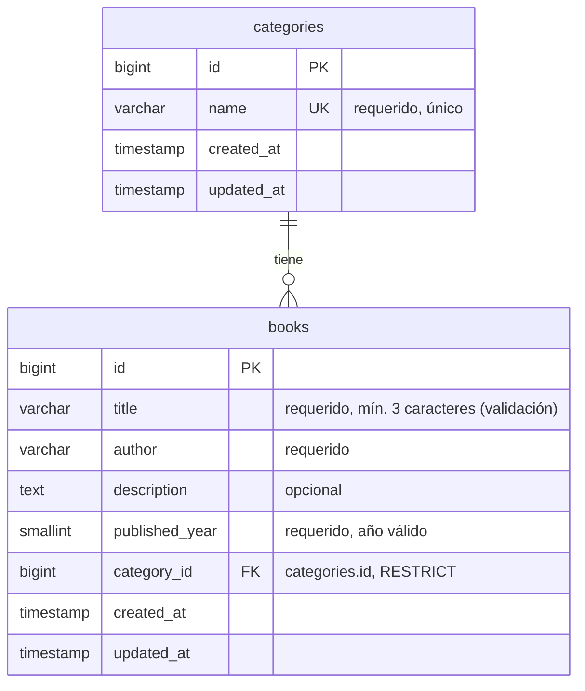

# Esquema de base de datos

Motor: **PostgreSQL**. Bases de datos: `library_backoffice` (desarrollo), `library_backoffice_test` (tests), `library_backoffice_e2e` (E2E).

## Diagrama

## Tablas

### `categories`
| Columna | Tipo | Restricciones |
|---|---|---|
| id | bigint (autoincremental) | PK |
| name | varchar(255) | NOT NULL, UNIQUE |
| created_at / updated_at | timestamp | nullable |

### `books`
| Columna | Tipo | Restricciones |
|---|---|---|
| id | bigint (autoincremental) | PK |
| title | varchar(255) | NOT NULL |
| author | varchar(255) | NOT NULL |
| description | text | NULL |
| published_year | smallint unsigned | NOT NULL |
| category_id | bigint | NOT NULL, FK → `categories.id`, `ON DELETE RESTRICT`, índice |
| created_at / updated_at | timestamp | nullable |

**Relaciones Eloquent**: `Category hasMany Book`; `Book belongsTo Category`.

**Integridad**: `ON DELETE RESTRICT` impide a nivel de BD borrar una categoría con libros (refuerza la regla de negocio, que además se valida en código).

## Tablas de infraestructura (skeleton de Laravel)
`users` (acceso al panel Filament y a la API), `password_reset_tokens`, `sessions`, `cache`, `cache_locks`, `jobs`, `job_batches`, `failed_jobs`, y `personal_access_tokens` (Laravel Sanctum).

## Seeders
`UserSeeder` (usuario administrador), `CategorySeeder`, `BookSeeder`; orquestados por `DatabaseSeeder`.
